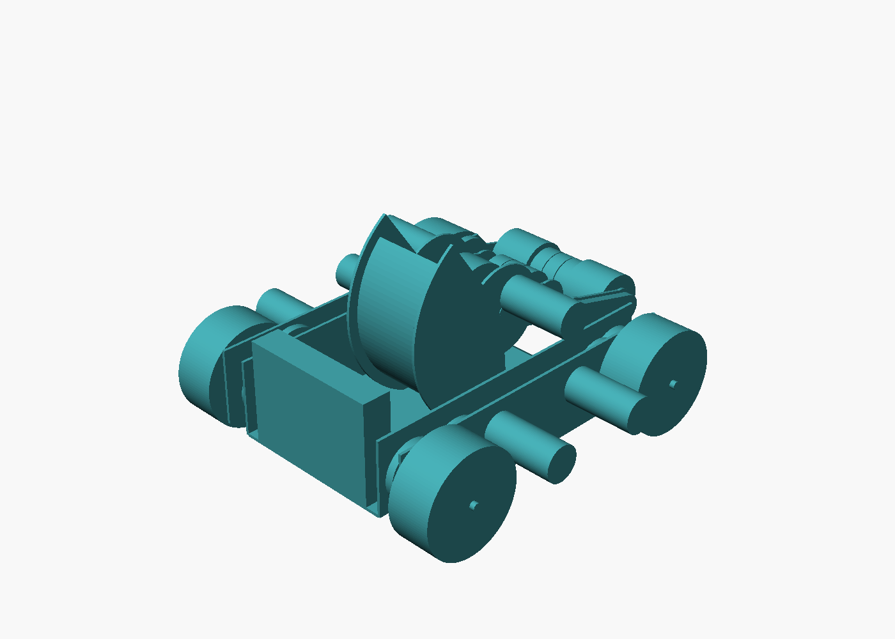
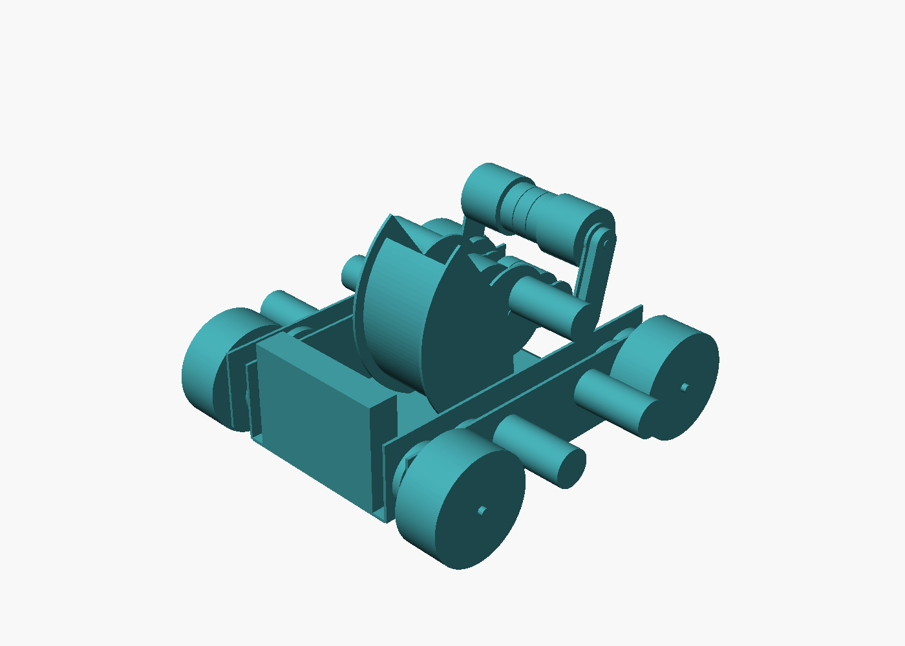

# FTC BIOBUZZ shooter bot (2026-27 season)

A small, low, lightweight mecanum robot for the BIOBUZZ game piece
(POLLEN, a ~2.8 in / 71 mm polyethylene ball): straight (non-turreted)
flywheel shooter over a curved hood, a swing-arm intake with gecko wheels in
the centre and vectored wheels at the ends, and four 104 mm goBILDA mecanum
wheels each driven by a bare 6000 rpm motor through a 12:1 two-stage gearbox.

**Status: CAD-validated.** Every pair of parts was boolean-intersected (0
interferences in both intake positions) and the ball was swept along its whole
path with 3 mm clearance against everything it is not meant to touch (0
violations). Not built, not simulated for shot distance. Fasteners, pocketing,
bearings, brackets, wiring and the belt tensioner are intentionally omitted.



| | |
| --- | --- |
| Envelope (intake deployed) | 370 (X) x 377 (Y) x 210 (Z) mm, incl. motor cans |
| Envelope (intake stowed) | 364 x 377 x 210 mm; fits the 18 x 24 x 29 in sizing volume with room to spare |
| Mass estimate | ~6.1 kg incl. Control Hub + battery placeholders; CG at z = 67 mm |
| Ground clearance | 17 mm under the deck, 18 mm under the pod plates |
| Drive | 6000 rpm -> 500 rpm (12:1), 2.7 m/s |
| Flywheel | 72 mm, 1:1 off a bare motor, 22.6 m/s tip speed, 135 deg hood wrap, 45 deg launch |
| Feed + intake | one bare motor, 3:1 to the feed roller, 1:1 belt to the arm roller, 5.0 m/s surface speed |

## Opening it in Fusion 360

Three options, from quickest to most native:

1. **Import the STEP.** `File > Open` (or *Insert > Insert Derive*) on
   `exports/ftc_biobuzz_bot_arm0.step` (intake deployed) or `_arm90.step`
   (stowed). Components are grouped (`pod_L`, `pod_R`, `chassis`, `shooter`,
   `feed`, `intake_arm`, `electronics`, `pollen_path`) and every body is named.
   The `pollen_path` component holds translucent balls at the checked positions
   so you can see the game-piece path.
2. **Run the Fusion script.** *Utilities > Add-Ins > Scripts*, add the folder
   `fusion/`, run `build_in_fusion.py`. It rebuilds everything natively from the
   same parametric spec (edit `fusion/robot_spec.py` -> rerun). It asks for the
   arm angle. Written against the Fusion API docs; it could not be executed
   here, so expect to fix an API nit or two on first run.
3. **Live through the MCP bridge.** Install `tools/fusion-mcp` (see its README),
   then a Claude Code session on the Fusion machine can build, screenshot and
   import goBILDA STEP files interactively.

`exports/parts_manifest.json` lists every COTS part with its instance name,
axis and centre, so each placeholder can be replaced with the real goBILDA STEP
(downloadable from each product page) and dropped on the same position.

## Layout (mm, X forward, Y left, Z up, origin on the floor)

**Drive pods.** Each side is two 3 mm plates (x -165..160, z 18..95) 24 mm
apart. The wheel sits outside the outer plate on an 8 mm REX axle; the two gear
stages live in the cavity between the plates; the bare motor is bolted to the
*outside* of the outer plate with its can pointing outboard, next to the wheel.
That keeps the whole interior free for the ball at deck level instead of
forcing the ball path up over four motor cans.

Gear train per wheel, MOD 1 (printed, or 20DP equivalents with centre
distances recomputed): motor 16T -> 64T on an idler shaft (4:1), idler 20T ->
60T on the axle (3:1). Both centre distances are 40 mm, the train leans 10 deg
up and inboard, so the motor axis ends up 80 mm from the wheel axis and the
can clears the 104 mm wheel by 10 mm. The 64T (66 mm OD) clears the plate
bottom by 8 mm.

**Deck.** One 3 mm sheet (x -165..115, y +-85.5, z 17..20) between the inner
pod plates ties the pods together; the front edge is bent down 35 deg as the
entry lip (tip 5 mm off the floor). A 24 mm square cross tube sits on the deck
at x -134..-110. The Control Hub stands at the back (x -165..-135) and the
battery lies flat ahead of the tube: both below z 50 and inside the hood arc.
If you want more torsional stiffness, bend 15 mm flanges on the deck's long
edges; nothing else is in the way.

**Shooter.** Flywheel axle at (x 30, z 120.1). Ball-centre orbit radius 61.55,
hood inner radius 97.1 (10 mm ball compression), hood sheet 3 mm polycarbonate
lying on the deck at the nip and wrapping 135 deg from straight below the axle
to the exit, which launches at 45 deg forward and up, over the intake. Side
plates at y +-40..43 (ball channel 80 wide) stand on the deck and carry the
flywheel shaft, the 1:1 MOD 0.8 24T gear pair inside the right plate, the
flywheel motor outboard right, and the feed shaft.

**Feed roller / intake pivot.** Three 48 mm gecko wheels on an 8 mm REX shaft
at (x 90.7, z 105.1): 10 mm squeeze on a ball on the deck, 2.5 mm from the
flywheel. The feed roller lets go of the ball 3.2 mm *after* the flywheel has
already started compressing it, so the hand-over does not rely on momentum.
Driven 3:1 (24T:72T, MOD 0.8) by the second bare motor, outboard left, with the
motor 30 deg up and rearward of the shaft so the swinging arm never meets it.

**Swing arm.** 3 mm arm plates at y +-70..73 pivot on the feed shaft; roller
71.6 mm from the pivot, deployed at (x 160, z 87.1) where the three centre
geckos press a ball on the floor by 8 mm, right in front of the lip. Vectored
2.25 in wheels at the ends (y 25..69 each side) pull balls toward the centre.
The arm floats up as a ball passes under it; stowed = rotated 90 deg up
(roller top at z 203). The 1:1 belt from the pivot to the roller is drawn as a
solid stadium placeholder on the right side.



## Assumed dimensions (replace with the real STEP and re-run the check)

| Part | Assumed | Why it matters |
| --- | --- | --- |
| 104 mm GripForce mecanum width | 45 mm | shifts the whole pod stack in Y; nothing inboard depends on it |
| Bare 5000-series motor | 36 mm dia, 72 mm long incl. encoder | can diameter sets the 10 mm wheel gap and plate height; length only sets overall width (377) |
| Gecko 48 mm width | 16 mm (retailer figure) | roller spacing only |
| Vectored intake wheel | 57 x 44 mm (AndyMark 2.25 in) | arm-plate spacing (fits with 1 mm to spare) |
| POLLEN | 71.1 mm, 10 / 8 mm compression | hood radius, roller heights |
| Flywheel | 72 x 30 mm (two 72 mm wheels) | hood radius; a 96 mm flywheel also fits but needs the feed roller moved |

Gears are drawn as cylinders 0.3 mm under pitch radius so meshing pairs register
as a 0.6 mm gap, not a clash. Shafts are round 8 mm stand-ins for REX.

## Re-running the checks

```bash
pip install cadquery
```

```bash
python3 cad/build_cadquery.py --arm 0      # deployed: checks + STEP/STL export
```

```bash
python3 cad/build_cadquery.py --arm 90     # stowed
```

The script prints the interfering pairs, every pair closer than 2 mm (the
intended contacts, for review), ball-path violations, mass/CG and the
envelope, and writes `exports/check_arm*.json`. Exit code is non-zero on any
interference or ball-path violation.

## Honest limitations

- The outboard motor cans are the widest point of the robot and would take
  wall hits first. A bumper rail at y +-190 is the obvious add.
- No arm hard-stop or spring is modelled; the deployed angle is a resting
  position the stop must provide.
- Shot range was not computed: 22.6 m/s tip speed on a 24 g ball is plenty, but
  the 45 deg launch angle should be tuned to the goal once its height is known.
- The 12:1 printed gearbox is the mechanically riskiest part (printed 16T
  pinion on a bare motor). A 15T steel pinion of the same module is the usual
  fix; the 64T then grows by 1 mm of centre distance, still inside the plate.
- Pollen are "not perfectly spherical" per the manual; hood compression of
  10 mm absorbs that.
